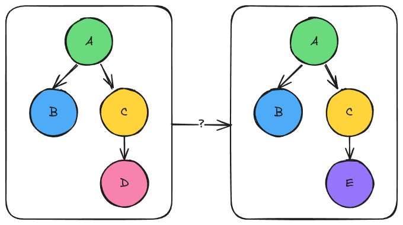

.. Copyright 2026 NWChemEx-Project
..
.. Licensed under the Apache License, Version 2.0 (the "License");
.. you may not use this file except in compliance with the License.
.. You may obtain a copy of the License at
..
.. http://www.apache.org/licenses/LICENSE-2.0
..
.. Unless required by applicable law or agreed to in writing, software
.. distributed under the License is distributed on an "AS IS" BASIS,
.. WITHOUT WARRANTIES OR CONDITIONS OF ANY KIND, either express or implied.
.. See the License for the specific language governing permissions and
.. limitations under the License.

.. _driver_design:

#################
Designing Drivers
#################

This page describes the design of drivers. A driver is a module that owns and
configures the call graph below it. It replaces the convention that a "driver
module" is simply a module whose ``run_`` mostly calls submodules.

*****************
What is a Driver?
*****************

Drivers are modules that manage the entire call graph below them. They need the
ability to set inputs/submodules non-locally. Drivers are essential for hiding
the complexity of a call graph from the user, and for allowing multiple
configurations of the same call graph to easily be used in the same session.

***********************
Why Do We Need Drivers?
***********************

.. _fig_switching_modules:

   Left the original graph. Right the graph resulting from using module "E"
   instead of "D". The question is how can both graphs be loaded into the
   ``ModuleManager`` simultaneously?

Consider the two graphs shown in :numref:`fig_switching_modules`. Let's call
the left graph "L" and the right graph "R". If we choose to have graph "L" be
the default graph that is loaded into the ``ModuleManager`` the user can go
from  graph "L" to graph "R" by telling the ``ModuleManager`` to switch the
submodule node "C" uses from node "D" to node "E". While viable, this is not
necessarily user-friendly as running "R" vs "L" means the user needs to know to
switch "D" to "E".

If we wanted to make it easy to run both "R" and "L" one option is to make
copies of the "A" and "C" modules. Let "RA" and "RC" respectively be those
copies. Then it becomes possible to have both the "L" and "R" graphs loaded into
the ``ModuleManager`` by default. More specifically, the original "A" module
still encodes the "L" call graph and nothing changes. To encode the "R" graph
we wire "RC" to call "E" and "RA" to call "B" and "RC". Users executing "RA"
then get the "R" call graph. While this solution works, it can be tedious
depending on how nested the graph is. It also can be wasteful because the two
graphs may have a substantial amount of overlap.

In summary: drivers are needed to automate this process. We want a user to be
able to tell the driver "I want configuration L" or "I want configuration R"
and have the driver handle the wiring details.

A Motivating Example
====================

The initial implementations of QCUP-SCF ran the same SCF loop as an ordinary
SCF calculation, but it:

- asked the integral modules for uncertain values instead of ``double`` values,
- replaced the four-center ERIs with an ERI module that attaches an error
  model,
- picked one of several error models, each with its own inputs, and
- attaches uncertainty to the converged orbitals and energy.

This took about twenty ``change_input`` and ``change_submod`` calls on
modules across four plugins. These calls lived in an application, not in any
plugin. This approach has several problems:

#. There was no single place to look. A user who wanted to change the error
   model had to know which module, several levels below the SCF driver, held
   the choice.
#. The settings were not first-class. They were arguments of a helper function,
   so PluginPlay could not list them, document them, or record them.
#. The wiring changed the ``ModuleManager``'s modules in place. An ordinary
   SCF and a QCUP-SCF could not be used in the same session, and neither
   could two QCUP-SCFs with different error models, *e.g.*, for a dimer and its
   monomers.
#. Every application that wanted QCUP-SCF had to repeat the wiring.

This was the switching problem from :numref:`fig_switching_modules`, at scale.

***************************************
How Does a Driver Differ From a Module?
***************************************

Drivers are a type of module. So they have all the properties of a module. Both
drivers and modules can be thought of as the root of a call graph. The key
difference is that a driver can set inputs and submodules for all modules in
its call graph, while a module can only manage its own inputs and submodules.

.. note::

   In practice, there's nothing stopping a module from making a copy of its
   call graph, changing inputs/submodules of the copies, and then running the
   copies. Conceptually this is how the driver works. By using a
   driver, you don't have to manage this machinery yourself.

To facilitate setting non-local inputs/submodules, drivers have additional
methods which allow the driver to declare which inputs/submodules to
forward and where they should be forwarded to. To enable the non-local
propagation, when a driver is locked, *i.e.*, when it is first run, it gets a
private copy of every module below it. Modules do NOT get private copies.

*********************
Driver Considerations
*********************

#. Drivers target a plugin, or series of plugins. They are not meant to be
   fully general.

   - This means drivers will have some idea of what modules can be below them
     and what other modules are available to them.
   - This also means that drivers will assume a certain modularity of the call
     graph. For example, a driver may assume that two steps are always done
     as two separate modules, whereas some modules may combine the steps into
     one module.
   - A driver can live in a plugin that does not load the other plugins it
     targets. The modules it needs from them are defaults from preferred
     providers, so the driver works with whichever providers are loaded (see
     `Drivers and Plugins`_).

#. Drivers are modules

   - There is one concept, not two. A driver is written, configured, run,
     memoized, and used as a submodule like any other module.
   - Users do not learn a new API. Settings are module inputs and submodules.
   - Existing modules are unaffected unless they opt in by deriving from
     ``DriverBase``.
   - Whether a module is a driver follows from its type, not from what its
     constructor happens to call.

#. Fixed vs forwarding settings

   - If the driver directly set a submodule's input/submodule to a value, that
     is termed a "fixed" setting. Every run of the driver will always set that
     setting to the same value. Since these run in the driver's constructor,
     they are set before the inputs to the driver are known and cannot depend
     on user input.
   - Forwarded settings set the inputs/submods of the driver's submodules to the
     values of the driver's inputs/submodules. These are set when the driver is
     run so they can depend on user input. The settings to forward, but not the
     values, are declared in the driver's constructor.

#. One place for the user

   - Users see the settings as attached to the driver and don't need to know
     where these settings are used.

#. Settings are targeted.

   - Each forwarded setting (input or submodule) names the module(s) and
     input/submodule it affects.
   - There is no "settings object" that modules are expected to read. The driver
     changes a targeted submodule's inputs/submodules directly, so that module
     cannot silently ignore the changes.

#. Settings may stop applying

   - The user can change the call graph in ways the driver did not anticipate,
     *e.g.*, by swapping a submodule. This may cause a module to be removed
     from the call graph, meaning the setting has nothing to change.
   - Such a setting is "inactive."" It is skipped and reported, not treated as
     an error, since the user's change made it irrelevant.
   - A setting whose target is not known to the ``ModuleManager`` at all is an
     error, since it is almost certainly a typo.
   - A driver author can mark a setting that must take effect as required.

#. Settings can choose submodules

   - Some settings choose an algorithm, *e.g.*, which error model to use.
     These are submodules of the driver, forwarded to the module that uses
     them. Because they are submodules, the choice is checked against a
     property type.

#. Drivers do not change the ModuleManager's modules

   - A driver works on its own copies. The modules it was copied from can
     still be used directly.
   - Two drivers that differ only in their settings can be used side by side.

#. Copies preserve sharing

   - A module that is used in more than one place in the call graph is copied
     once.

#. Wiring happens once

   - A driver is wired when it is locked. Calls after the first do not copy or
     rewire anything.
   - To use other settings after a driver is locked, the user copies the
     driver, as for any other locked module.

#. Wiring may be conditional

   - A setting may only apply if another input has a certain value.

#. Drivers compose

   - A driver can be used inside another driver. The enclosing driver
     configures the nested driver through the nested driver's inputs and
     submodules.

#. Python

   - Modules written in Python must be able to be drivers.

***********************
Alternatives Considered
***********************

Before the current design doc, driver modules were a consideration of the
module design doc. This is the origin of "Design 1.0" and "Design 2.0" below.
Realizing that neither Design 1.0 or Design 2.0 solved the problem, the other
alternatives in this section were considered.

Design 1.0
==========

To ensure that driver modules interoperate with other modules, driver modules
also inherit from ``ModuleBase``. We want the
``run`` member of the driver module to have minimal branching, thus logic for
swapping modules should happen before ``run`` is called. Our solution is to
introduce ``ModuleBase::pre_run``. This method allows the derived module to
manipulate the input values and submodules ``run`` will call before they are
passed to ``run``. By default ``ModuleBase::pre_run`` will just return the
inputs and submodules provided to it. To define a driver module, the module
developer overrides the default implementation. For symmetry we also introduce
``ModuleBase::post_run`` which allows the derived class to manipulate the
results before they are given back to the caller of ``Module::run``.

The official C++ API for declaring a module is to use the ``DECLARE_MODULE``
macro. If the user is going to override ``pre_run`` or ``post_run`` this changes
the declaration needed (i.e., the signature for ``pre_run`` and/or ``post_run``
must be part of the declaration). To avoid an API break we introduce a new macro
``DECLARE_MODULE_DRIVER``, for symmetry we require users to override both
``pre_run`` and ``post_run`` if they choose to write a driver (even if they
only need one or the other).

Design 2.0
==========

.. note::

   This is here for historic context, it's NOT current.

In prototyping design 1.0, it was realized that ``Module::run`` looks like:

.. code-block:: c++

   std::tie(inputs, submods) = module.pre_run(inputs, submods);
   auto rv = module.run(inputs, submods);
   rv = module.post_run(inputs, submods, rv);

With nothing between ``pre_run`` and ``run`` (or ``run`` and ``post_run``) there
is no reason (aside from partitioning preference) why the module developer can't
just put their pre-run and post-run logic inside their module's run overload.
More specifically the same inputs and submods that would go to ``pre_run`` can
just be fed to ``run``, then the same logic which would have happened in
``pre_run`` can just happen in ``run``. Similarly all information which would
have been fed into ``post_run`` is also available in ``run``.

Ultimately, it was thus realized that pre- and post- conditions can be handled
as is. Neither design 1.0 or 2.0 solved the driver problem:

- **Design 1.0** added ``pre_run`` and ``post_run`` hooks to ``ModuleBase`` so
  that a driver module could change its inputs and submodules before running.
- **Design 2.0** observed that anything ``pre_run`` and ``post_run`` can do,
  ``run_`` can do, and dropped the hooks.

Design 2.0 is correct about pre- and post-conditions, but it left the switching
problem to the author of each module. A module that wants to run a
different graph has to copy and rewire its submodules inside ``run_`` on every
call. Since ``unlocked_copy`` copies one module and shares its submodules
(``ModulePIMPL``'s copy constructor copies the ``shared_ptr`` to each
submodule), rewiring a module three levels down means copying every module on
the path by hand. This tightly couples the module to the graph below it, and
requires a significant amount of boilerplate code to appear in each driver.

A separate recipe class
=======================

A ``ModuleRecipe`` class, separate from ``ModuleBase``, would name a root
module, hold fixed wiring and typed options, and produce a configured copy of
the root module's call graph on first use.

- This solves the problem, but adds a second concept next to modules, with
  its own API (``add_recipe``, ``recipe``, ``copy_recipe``,
  ``change_option``) and its own Python ownership rules.
- Options would be a parallel system to module inputs, with their own type
  checking, memoization, and provenance.
- It leaves "driver module" as an unsupported naming convention, so the term
  "driver" stays ambiguous.

Hierarchical sub-drivers
========================

Every module in the call graph declares the settings of every module below it
as its own inputs, and forwards them inside ``run_``:

.. code-block:: c++

   MODULE_RUN(SCFLoop) {
       // Submodules are locked and shared, so they must be copied first
       auto f_mod = submods.at("Fock matrix builder").value().unlocked_copy();
       f_mod.change_input("UQ Type", inputs.at("UQ Type").value<std::string>());
       // ... and the Fock builder repeats this for the J and K builders
   }

- Modules that do not care about a setting, *e.g.*, the Fock matrix builder,
  gain inputs for it.
- Adding a setting changes the inputs of every module above the one that uses
  it.
- Every module on the path copies its submodules on every call, and two
  parents can set conflicting values on a shared module.

A variant asks each submodule for its settings at runtime. This avoids
listing the settings at compile time, but has the same remaining problems.

A shared settings module
========================

This generalizes the ``UQ Initializer`` module from Integrals. Every module
that needs a setting takes a ``"Settings"`` submodule, and every such
submodule is bound to the same module, so one ``change_input`` reaches all of
them.

- This works well when the shared module does one thing. ``UQ Initializer``
  only answers "how do I make an uncertain value?".
- A general settings module is a contract that is not enforced. A new setting
  may not be read by the modules it is meant for, and two settings may
  conflict. Nothing reports either problem.

Promoted inputs
===============

Similar to promoted variables in OpenMDAO, the ``ModuleManager`` would link
one input of a module to inputs of other modules:

.. code-block:: c++

   mm.promote_input("My driver", "Tolerance",
                    {{"My step", "Tolerance"}, {"A helper", "Tolerance"}});

- This changes the ``ModuleManager``'s modules in place, so it has the third
  problem from `A Motivating Example`_.

Forwarded inputs are promoted inputs whose targets are the driver's private
copies. The private copies remove the reason promoted inputs were rejected.

A wiring function
=================

Each application, or one shared package, provides a function such as
``configure_qcup(mm, uq_type, error_model)``.

- This is how QCUP-SCF was first implemented. The settings were not first-
  class, and the ``ModuleManager``'s modules were changed in place (see
  `A Motivating Example`_).

***************
Driver Strategy
***************

The design adds a ``DriverBase`` class, derived from ``ModuleBase``, with
functions to declare forwarding and fixed wiring. It extends locking to build a
driver's private call graph, and adds a function that copies a module together
with every module below it. Users of a driver still only see ``Module``.

The DriverBase Class
====================

``DriverBase`` would be declared in ``pluginplay/driver/driver_base.hpp``.
Putting the new functions in a class of their own, rather than in
``ModuleBase``:

- makes being a driver a property of the type, so module authors and
  PluginPlay can tell drivers from other modules;
- guarantees that modules which do not derive from ``DriverBase`` keep
  today's behavior; and
- keeps ``ModuleBase``, which every module derives from, unchanged.

A sketch of the class:

.. code-block:: c++

   class DriverBase : public ModuleBase {
   public:
       // Read-only views of what the constructor declared
       const forward_list_type& forwarded_inputs() const noexcept;
       const forward_list_type& forwarded_submods() const noexcept;
       const wiring_list_type& wiring() const noexcept;

   protected:
       template<typename DerivedType>
       explicit DriverBase(DerivedType* self) : ModuleBase(self) {}

       // Called from the derived class's constructor
       WiringRecord& forward_input(type::key input_key, type::key module_key,
                                   type::key target_input_key);
       WiringRecord& forward_submod(type::key callback_key,
                                    type::key module_key,
                                    type::key target_callback_key);

       template<typename T>
       WiringRecord& wire_input(type::key module_key, type::key input_key,
                                T value);
       WiringRecord& wire_submod(type::key module_key, type::key callback_key,
                                 type::key submod_key);
       void wire_memoization(bool on, std::vector<type::key> except = {});

       template<typename T>
       ConditionalWiring& when(type::key input_key, T value);

   private:
       // The forwarding and wiring records, in the order they were declared
   };

The constructor takes the derived object, as ``ModuleBase``'s does, so that
``ModuleBase`` can still record the derived type.

``Module`` holds its implementation through a ``ModuleBase`` pointer, so code
that has a ``Module`` can not see the type directly.

The module macros have driver versions, so a driver is declared the same way a
module is:

- ``DECLARE_DRIVER(driver_name)`` declares a class ``driver_name`` that derives
  from ``DriverBase``.
- ``DRIVER_CTOR(driver_name)`` starts the definition of its constructor.
- ``MODULE_RUN(driver_name)`` defines its ``run_``, unchanged, since ``run_``
  has the same signature for drivers and modules.

Declaring a Driver
==================

A driver's constructor calls these protected ``DriverBase`` functions, in
addition to the usual ``satisfies_property_type``, ``add_input``, and
``add_submodule``:

- ``forward_input(input_key, module_key, target_input_key)`` records that the
  value of the driver's input ``input_key`` is also set as the input
  ``target_input_key`` of the module ``module_key`` below the driver.
- ``forward_submod(callback_key, module_key, target_callback_key)`` records
  that the module bound to the driver's submodule ``callback_key`` is also
  bound as the submodule ``target_callback_key`` of the module ``module_key``.
- ``wire_input(module_key, input_key, value)`` and
  ``wire_submod(module_key, callback_key, submod_key)`` record fixed wiring.
- ``wire_memoization(on, except)`` records whether the copies memoize,
  except for the modules whose keys are in ``except``.

The forwarding and wiring functions return the ``WiringRecord`` they
created, so that the record can be marked as required (see
`Missing Targets`_):

.. code-block:: c++

   forward_input("Tolerance", "My step", "Tolerance").required();

An input or submodule may be forwarded to several targets by calling the
function once per target. Module keys may be qualified keys, as for
``ModuleManager::at``, *e.g.*, ``{"integrals", "ERI4"}``.

A forwarded input must not be an input of a property type the driver
satisfies. Property-type inputs are passed on every call, and a new value on
every call would mean rewiring on every call. Forwarded inputs are set with
``change_input`` before the driver is locked.

A forwarded input or submodule is still an ordinary input or submodule of the
driver. Its default, description, and property type are declared as usual, and
the driver's ``run_`` may use it too.

The functions record their arguments in ``DriverBase``. ``Module`` exposes
them read-only through ``forwarded_inputs()``, ``forwarded_submods()``, and
``wiring()``, which are empty for modules that are not drivers.

Users can add fixed wiring of their own, *e.g.*, to override a choice the
driver makes, with ``Module::wire_input`` and ``Module::wire_submod`` before
the driver is locked. These are stored in ``ModulePIMPL``, like changed inputs.

This is the way to override a driver's choice. Changing the
``ModuleManager``'s module instead, *e.g.*, with
``mm.change_submod("A", ...)``, changes the module the driver copies from. The
driver's fixed wiring is applied to the copy afterwards, so a driver that
wires the same slot overrules the user's change. The user's wiring on the
driver is applied after the driver's own, so it wins.

Conditional Wiring
==================

Some settings change several things at once. ``forward_input`` and
``forward_submod`` can not express this, since they pass a value through
unchanged.

``when(input_key, value)`` starts a block of wiring that applies only if the
driver's input ``input_key`` equals ``value`` when the driver is locked:

.. code-block:: c++

   add_input<bool>("Enable feature").set_default(false);

   when("Enable feature", true)
       .wire_submod("Module A", "Submodule",
                    "Module to use when feature is enabled");

- **One condition per block.** Everything a value changes is written in one
  place, so a reader, and PluginPlay, can answer "what does the input
  change?" ``Module::wiring()`` lists each block under its condition.
- **Several values.** An input with more than two values, *e.g.*, a string
  input gets one block per value.
- **No match.** If no block's condition holds, no conditional wiring is
  applied. The driver's fixed wiring is the default, so the block for the
  default value can usually be omitted.
- **Several matches.** Every block whose condition holds is applied, in the
  order the blocks were declared.
- **Same rules as other wiring.** A block contains ``wire_input`` and
  ``wire_submod`` records. They are applied after the driver's fixed wiring
  and before the user's wiring, so users can still override them (see
  `Locking a Driver`_). Inactive records are reported like any other (see
  `Missing Targets`_), and ``required()`` on a block marks every record in it
  as required.
- **Same restriction on inputs.** The condition's input must not be an input
  of a property type the driver satisfies, for the same reason as forwarded
  inputs.

Because a block is data rather than code, it is exported to Python as is,
*e.g.*, ``self.when("Density fitting", True).wire_submod(...)``, and it can
be recorded with the driver's results.

Complicated Choices
-------------------

A condition tests one input against one value. A choice that depends on
several inputs, or that needs other logic, belongs in a driver of its own:

- If the affected modules share a parent that can be swapped, write a driver
  for each configuration of that parent. The outer driver forwards a submodule
  for the parent, and the user, or a
  ``when`` block, picks which driver fills it. Each configuration is then
  type-checked by its property type, and the rules for nested drivers apply.
- Otherwise, write a driver whose ``run_`` dispatches between submodules, one
  per configuration, based on its inputs.

To enable arbitrary logic we would need to support lambdas, which are opaque
to PluginPlay. Turning the logic into a driver makes it visible so that it can
be read, tested, and reused by PluginPlay.

Locking a Driver
================

``ModulePIMPL::lock`` already locks a module's submodules before locking the
module itself. If the module is a driver, locking first builds the driver's
private call graph:

#. **Copy the call graph.** Make an unlocked copy of every module reachable
   from the driver's submodules. Each distinct module is copied exactly once,
   and the copies are linked to each other in the same pattern as the
   originals. A module that was shared stays shared within the copy.
#. **Apply the wiring**, in this order:

   #. the driver's fixed wiring, in the order it was declared;
   #. the driver's conditional wiring whose condition holds, in the order it
      was declared (see `Conditional Wiring`_);
   #. the user's fixed wiring, in the order it was added;
   #. forwarded inputs and submodules, in the order they were declared; and
   #. the memoization policy.

   The last write to a target wins. A driver does not check for two writes to
   the same target, since the wiring is written by hand and "last write wins"
   is easy to explain. Targets that are missing from the call graph are
   handled as described in `Missing Targets`_.
#. **Rebind the driver's submodules** to the copies.
#. **Lock** the copies, then the driver, as today.

A ``wire_submod`` record or a forwarded submodule may name a module that is not
yet in the copied call graph. That module and everything below it are copied
into the call graph first, using the same rules. Finding a module by key needs
the ``ModuleManager``. The ``ModuleManager`` already gives each module its
runtime
and caches through ``ModulePIMPL::attach``; it would also give each module a
way to look up modules by key.

Missing Targets
---------------

Consider a driver written with the left graph of
:numref:`fig_switching_modules` in mind, which sets inputs of module "D".
Before running the driver, the user swaps module "C" for a module "F" that
does not call "D". When the driver is locked, "D" is not in its call graph, and
the settings that target "D" have nothing to change.

Making this an error would forbid the very changes drivers are meant to
support. The same situation arises within a single driver whenever a setting
only matters for one choice of submodule. Ignoring it silently would hide typos
and modules that a newer version of a plugin renamed. Locking therefore tells
the two cases apart:

#. **The key is unknown.** The ``ModuleManager`` has no module with the
   target's key. This is an error. The message names the driver, the wiring
   record, and the key. The exception is a qualified key whose plugin is not
   loaded, which is treated as the next case (see `Drivers and Plugins`_).
#. **The module exists but is not in the call graph.** The setting is
   inactive and is skipped. Locking logs one message per inactive setting
   through the runtime's logger, *e.g.*,
   ``"My configurable driver": "Tolerance" has no effect because "A helper"
   is not in the call graph``. A target field that does not exist on a module
   that is in the call graph, *e.g.*, a misspelled input key, is an error.

A record marked ``required()`` must take effect. If it would be inactive,
locking throws, with the same message that would have been logged. Driver
authors use this for settings where doing nothing would give wrong results,
rather than results the setting does not apply to.

Users can find inactive settings in two ways:

- ``Module::inactive_settings()`` lists them once the driver is locked.
- ``Module::check_wiring()`` builds the call graph as locking would, reports
  inactive settings and errors, and then discards the call graph. This lets a
  user see the effect of a change before paying for a calculation.

A setting that targets "D" still applies if "D" is reachable some other way,
*e.g.*, if "F" also calls "D". Targets name modules, not places in the call
graph (see `Identifying Modules in the Call Graph`_).

Identifying Modules in the Call Graph
-------------------------------------

A target is identified by the key of the module in the ``ModuleManager``, and
refers to the copy of that module in the driver's call graph. Since copies
preserve sharing, each module has exactly one copy. ``ModulePIMPL::attach``
already records each module's cache key, which is derived from the module's
key (``"<plugin>::<key>"``), and copies keep it. The copy function uses it to
map keys to copies.

Copying a Locked Driver
-----------------------

``ModulePIMPL`` keeps the driver's submodule bindings from before locking.
``unlocked_copy``, and therefore ``ModuleManager::copy_module``, gives a
driver with those original bindings, the current input values, and no private
call graph. The copy builds its own call graph when it is locked. To use other
settings after a driver is locked, the user copies it:

.. code-block:: c++

   mm.copy_module("QCUP SCF", "QCUP SCF taylor");
   mm.change_input("QCUP SCF taylor", "UQ Type", "taylor model");

Because the call graph is copied when the driver is locked, rather than when
the driver is added, changes the user makes to the ``ModuleManager``'s modules
beforehand, *e.g.*, a basis-set threshold, are picked up by the driver.

Nested Drivers
==============

A driver's call graph may contain other drivers. Two rules keep this simple:

- **One copy.** Only the outermost driver copies the call graph. A nested
  driver whose call graph has already been copied by an enclosing driver
  does not copy it again.
- **Encapsulation.** A driver's targets must not be below a nested driver. An
  enclosing driver configures a nested driver through the nested driver's
  inputs and submodules, which the nested driver then forwards. Since locking
  goes from the outermost driver inward, the enclosing driver's wiring is
  applied first, and the nested driver's forwarding then uses the values the
  enclosing driver set.

Drivers and Plugins
===================

A driver is added to a plugin like any other module. It usually needs modules
from other plugins, *e.g.*, a driver in ``MyPlugin`` that needs
``ProviderA``'s ``"A helper"``. The plugin's preferred providers handle this,
so a driver can live in a plugin that does not load the other plugins it
targets.

- **Choices from other plugins are submodules of the driver.** A module from
  another plugin is chosen by a submodule of the driver, forwarded to where it
  is used, rather than by fixed wiring. The plugin sets its default with
  ``default_submod_from``, as for any of its modules:

  .. code-block:: c++

     // In the driver's constructor
     add_submodule<MyPT>("Driver");  // the module this driver configures
     add_submodule<HelperPT>("Helper");
     forward_submod("Helper", "My step", "Helper");

     // In MyPlugin's constructor
     add_module<MyConfigurableDriver>("My configurable driver");
     change_submod("My configurable driver", "Driver", "My driver");
     default_submod_from("provider_a", "My configurable driver", "Helper",
                         "A helper");

- **Missing providers leave the driver not ready.** If no preferred provider
  for a submodule is loaded, the submodule stays unset, and the driver is not
  ready, like any other module with an unset submodule. Running it fails with
  the list of unset submodules, so the user knows which modules to load or
  supply.
- **Fixed wiring only names the plugin's own modules.** ``wire_submod`` names
  its module directly and has no fallback when a provider is not loaded, so
  its value should be a module from the driver's own plugin.
- **Targets may be in other plugins.** Targets are the driver's assumptions
  about the call graph (see `Driver Considerations`_), so they often name
  modules from other plugins. Such targets should use qualified keys, *e.g.*,
  ``{"provider_a", "A helper"}``, so that another plugin with a module of the
  same key can not make them ambiguous. If the target's plugin is not loaded,
  the setting is inactive, as if the user had swapped the module out (see
  `Missing Targets`_). The user may have supplied a replacement from another
  plugin on purpose.
- **Defaults are applied before the copy.** The ``ModuleManager`` applies
  defaults in ``wire_defaults``, and a driver copies its call graph when it is
  locked, which is after ``wire_defaults``. The copies therefore have every
  default that the loaded plugins set, both for the driver's own submodules
  and for the modules below it.

Python
======

Python modules derive from ``pluginplay.ModuleBase``. Python drivers derive
from ``pluginplay.DriverBase``, which is exported with a trampoline class like
``ModuleBase``'s, and call ``forward_input``, ``forward_submod``,
``wire_input``, ``wire_submod``, and ``wire_memoization`` in ``__init__``.
No new ownership rules are needed, since drivers are modules.

**********************
Further Considerations
**********************

- **Shared modules and nested drivers.** A module can be reachable both
  through a nested driver and directly from the enclosing driver. Both drivers
  may then target it. Locking goes outward to inward, so the nested driver's
  write wins. Whether that is the right choice should be revisited once there
  is a real example.
- **Memoization.** A copy of a module should be able to reuse results that the
  original computed when the inputs and submodules match. Copies keep the
  original's cache key, so this depends on how the module cache hashes
  submodules (see :ref:`memoization_design`). This needs to be checked when the
  copy function is implemented.
- **Wiring callbacks.** A virtual ``wire_(inputs, wiring)`` on ``DriverBase``,
  the wiring counterpart of ``run_``, could see all of a driver's inputs and
  add records with arbitrary logic. It is left out for now in favor of
  dispatch drivers (see `Complicated Choices`_), since a callback can not be
  inspected without running it. It can be added later if dispatch drivers
  prove cumbersome.
- **Paths.** Targets refer to a module by key. Paths such as
  ``"Loop/Fock matrix builder/J builder"`` may be useful to target one place
  in the call graph and are left for later.
- **Existing driver modules.** Modules like ``"SCF Driver"`` keep working
  unchanged. They become drivers in this sense only if their class is changed
  to derive from ``DriverBase``, *e.g.*, by switching from ``DECLARE_MODULE``
  to ``DECLARE_DRIVER``. Whether some of them should is a separate question for
  each repository.
