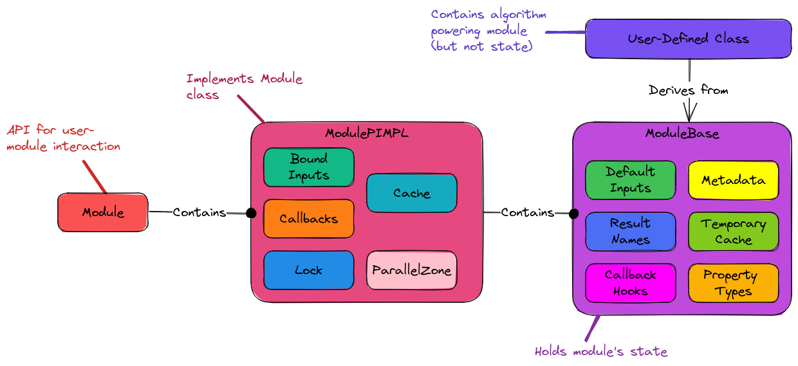

.. Copyright 2023 NWChemEx-Project
..
.. Licensed under the Apache License, Version 2.0 (the "License");
.. you may not use this file except in compliance with the License.
.. You may obtain a copy of the License at
..
.. http://www.apache.org/licenses/LICENSE-2.0
..
.. Unless required by applicable law or agreed to in writing, software
.. distributed under the License is distributed on an "AS IS" BASIS,
.. WITHOUT WARRANTIES OR CONDITIONS OF ANY KIND, either express or implied.
.. See the License for the specific language governing permissions and
.. limitations under the License.

.. _module_design:

##############################
Designing the Module Component
##############################

The :ref:`call_graph_design` section motivated the need for a module component
(although the fact that we've written "module" like a thousand times by now
ought to have suggested it too...).

*****************************
What is the Module Component?
*****************************

See :ref:`module` for PluginPlay's definition of a module. The module component
is primarily responsible for interfacing PluginPlay to the algorithm the
module developer wrote.

*******************************
Module Component Considerations
*******************************

.. _mc_user_interface:

User interface.
   Stemming from :ref:`call_graph_design`, one of the motivating factors for the
   module component is to provide a mechanism for a user to interface their
   algorithm with PluginPlay.

.. _mc_memoization:

Memoization.
   Also stemming from :ref:`call_graph_design`, caching/memoization of a module
   is the responsibility of the module component.

   - Ideally largely automated
   - Developers may need mark modules as incapable of being memoized when they
     are not sufficiently "pure" (*i.e.*, they have side effects, are
     non-deterministic, and/or depend on global input).

.. _mc_construction_phase:

Have a construction phase.
   Modules will ultimately be classes. The construction phase will happen in the
   constructor and may include:

   - Used by developer to register the module's metadata.
   - Also can initialize constant state needed by the module.

.. _mc_run_hook:

Expose a ``run`` hook.
   As agreed upon in :ref:`call_graph_design`, executing a module happens by
   calling a ``run`` member. Members of the module component must expose such a
   member.

   - The ``run`` member should contain minimal branching. Traditional if/else
     logic needed for determining what function to run should be handled by
     selecting submodules ahead of time.

.. _mc_store_call_back_points:

Store callback points.
   The graph only works if nodes can call other nodes. Modules must be able to
   call sub-modules, which requires somehow being able to hold the submodules.

***********************
Module Component Design
***********************

.. _fig_module_design:

   Module component design showing the contact points. Users of the
   module go through the ``Module`` class :ref:`api`. PluginPlay interacts with
   the user of the module via the ``ModulePIMPL`` class and the module developer
   via the ``ModuleBase`` class. Module developers interact with the component
   by deriving from ``ModuleBase``.

The design of the module component is shown in Fig :numref:`fig_module_design`.
The subsections below go over the major pieces in more detail.

Module Development
==================

Following traditional object-oriented practices module developers implement
modules by deriving from the ``ModuleBase`` class. In the constructor of their
module, module developers set the property type(s) their module satisfies,
any additional inputs/results (beyond those specified by the property type),
callback hooks used throughout, and the metadata (version, author, papers to
cite, *etc.*). The actual state provided in the constructor is stored in the
``ModuleBase`` part of the object and preserved in the state provided. When
users change inputs, or callbacks the user's requests are actually stored in
the ``ModulePIMPL``.

The other half of implementing a module is done when the module developer
overrides the ``run_()`` member. This member is assumed to be a pure function
(a pure function always returns the same results for the same inputs, and has
no side-effects). PluginPlay helps enforce this assumption by making the
``run_()`` member ``const``. The need for a pure function is brought on by the
desired black-box nature and for memoization purposes. To be treated as a black
box the module must receive no "hidden" inputs including from global variables,
files, or state not registered with PluginPlay. In practice, particularly when
considering modules meant to be called iteratively, a module may need access
to modifiable state. This is where the "Temporary Cache" comes in. The derived
class is able to put/get data in/out of the temporary cache using a key-value
system.

*******
Summary
*******

The above design specifically addresses the stated considerations by:

:ref:`mc_user_interface`

   - Module developers inherit from ``ModuleBase`` and fill in the virtual
     ``run_`` member.
   - Metadata for the module can be registered with ``ModuleBase`` (and thus
     PluginPlay) in the derived class's ctor.

:ref:`mc_memoization`

   - ``ModulePIMPL`` performs memoization.

:ref:`mc_construction_phase`

   - Derived classes use their constructor to set meta-data.

:ref:`mc_run_hook`

   - ``Module`` exposes the ``run`` (and more useful ``run_as``) which
     executes the module.

:ref:`mc_store_call_back_points`

   - ``ModuleBase`` records the hooks (property types and associated tag) for
     each call back location.
   - ``ModulePIMPl`` holds the bound callbacks for each hook.
